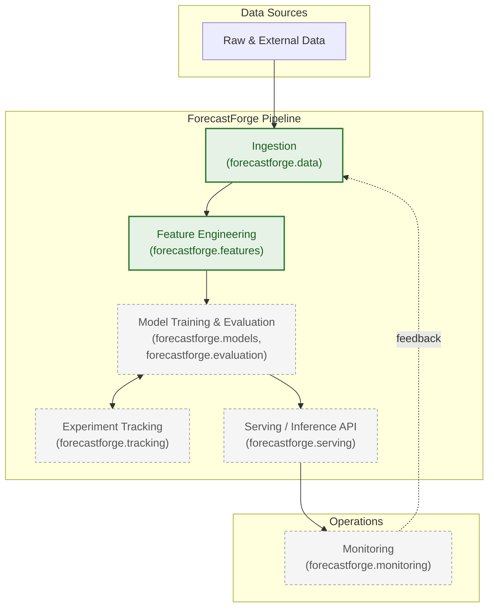
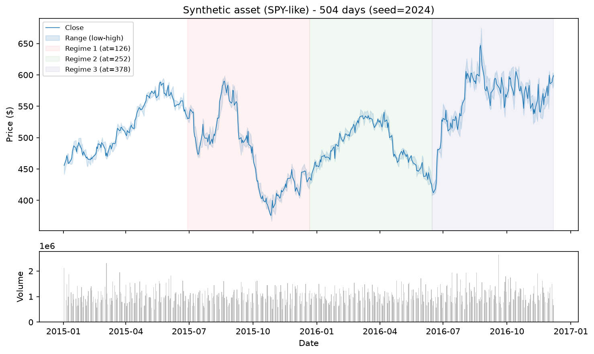
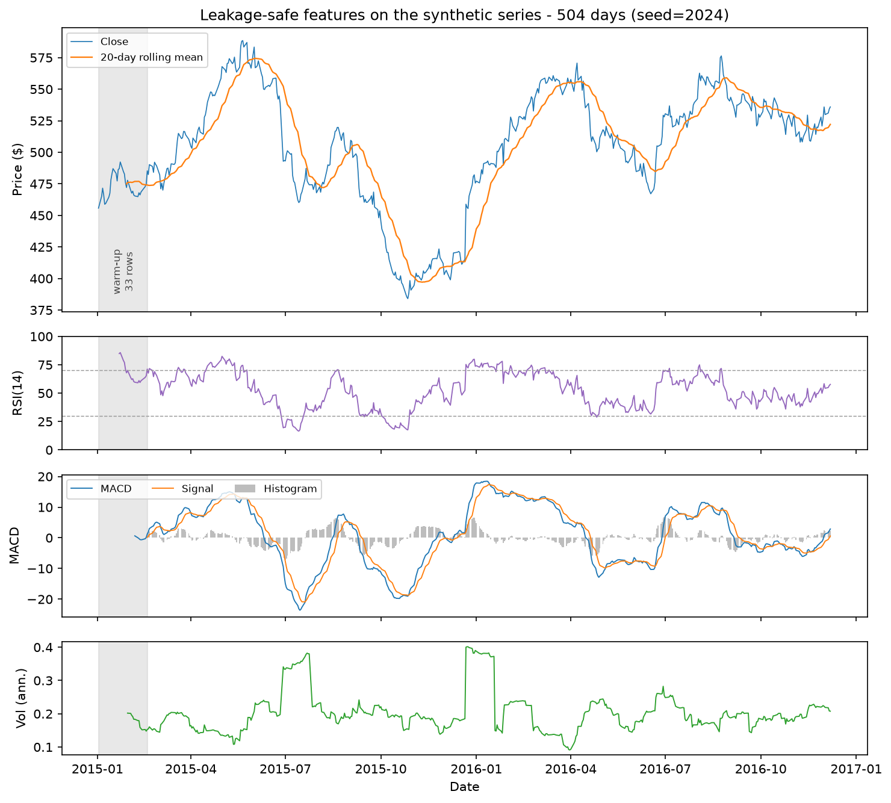

# ForecastForge

[](https://github.com/Abolfazlrwm/forecastforge/actions/workflows/ci.yml)
[](LICENSE)
[](https://www.python.org/downloads/)
[](https://github.com/astral-sh/ruff)
[](https://mypy-lang.org/)
[](https://www.conventionalcommits.org/en/v1.0.0/)
[](CODE_OF_CONDUCT.md)

> **Status: Pre-Alpha — foundation, data layer, and feature engineering.**
> **ForecastForge does not yet implement model training, evaluation,
> serving, or monitoring.** What exists and is tested: the core exception
> hierarchy, a validated ``TimeSeries`` container with structural
> validation, a fully-offline data ingestion layer (synthetic source, file
> loaders, and optional Yahoo Finance connector), and a leakage-safe
> feature engineering framework.

## Project Goals

ForecastForge aims to be an open-source, production-grade platform for
building, evaluating, and operating time-series forecasting systems at
scale. Concretely, the project is working toward:

- A **composable pipeline** that takes raw data through ingestion,
  feature engineering, model training/evaluation, and serving as
  independently testable stages.
- A **reproducible experimentation workflow**, where every training run
  is tracked, versioned, and comparable against prior runs.
- A **maintainable codebase** that a distributed group of open-source
  contributors — not just its original authors — can safely extend.
- A **deployable serving layer** that exposes trained models through a
  documented, versioned API.
- **Built-in observability**, so that data drift and model degradation
  in production are detected rather than discovered by users.

## Guiding Principles

- **Reproducibility** — deterministic environments, pinned tooling, and
  versioned experiment artifacts.
- **Observability** — structured logging and experiment tracking as
  first-class citizens, not afterthoughts.
- **Maintainability** — strict linting, static typing, automated
  testing, and a documented architectural decision record (ADR) trail
  so the project remains legible as it grows and as contributors
  change.
- **Composability** — a pipeline-oriented architecture where ingestion,
  feature engineering, modeling, and serving are independently testable
  and independently deployable stages.
- **Openness** — a governance and contribution model (see
  [CONTRIBUTING.md](CONTRIBUTING.md) and
  [CODE_OF_CONDUCT.md](CODE_OF_CONDUCT.md)) that welcomes external
  maintainers, not just a single team.
- **Incrementalism** — each phase of the project is scoped narrowly so
  the engineering foundation is solid before higher-risk,
  higher-complexity work (data ingestion, feature engineering, and
  modeling) begins.

## Architecture Overview

The diagram below shows the **target architecture** and marks which stages
exist today. Ingestion and feature engineering are implemented and tested;
model training, tracking, serving, and monitoring are still planned.



Design principles guiding future implementation phases:

- Each stage will be a separately testable, independently importable
  subpackage under `src/forecastforge/` (see
  [Repository Layout](#repository-layout) below), orchestrated by
  pipeline definitions under `pipelines/`.
- Configuration will be environment-driven (`configs/`, `.env`) and
  validated with `pydantic`, rather than scattered as magic constants.
  See `configs/development.toml`, `configs/testing.toml`, and
  `configs/production.toml` for the environment overlay structure.
- Experiment and run artifacts will be tracked under `mlruns/`, with
  raw, interim, processed, and external datasets kept in clearly
  separated `data/` subdirectories to prevent accidental mutation of
  source data.
- Containerization (`docker/`, `docker-compose.yml`) will formalize the
  runtime environment once services exist to containerize.
- Significant, hard-to-reverse architectural choices are recorded as
  ADRs under [`docs/adr/`](docs/adr/) — see
  [0001-use-src-layout.md](docs/adr/0001-use-src-layout.md) for the
  first example.

Full architectural documentation, including which stages are implemented,
lives in [docs/architecture.md](docs/architecture.md).

## Repository Layout

```
forecastforge/
├── .github/
│   ├── workflows/
│   │   └── ci.yml            # Lint, type-check, test, wheel smoke test
│   ├── ISSUE_TEMPLATE/        # Bug report and feature request forms
│   ├── dependabot.yml         # Automated dependency updates
│   └── pull_request_template.md
├── src/
│   └── forecastforge/         # Installable Python package (src-layout)
│       ├── config/             # Settings loading & validation
│       ├── core/                # Shared domain types & interfaces
│       ├── common/              # Cross-cutting helpers (placeholder)
│       ├── utils/                # General-purpose utilities (placeholder)
│       ├── data/                  # Data ingestion & access layer
│       ├── features/               # Leakage-safe feature engineering
│       ├── models/                  # Model definitions & training (planned)
│       ├── evaluation/               # Model evaluation & metrics (planned)
│       ├── tracking/                  # Experiment tracking integration (planned)
│       ├── serving/                    # Inference API layer (planned)
│       ├── monitoring/                  # Runtime & model monitoring (planned)
│       ├── pipelines/                    # Pipeline orchestration (planned)
│       └── schemas/                       # Shared data/config schemas
├── tests/                     # Automated test suite (pytest)
├── docs/                      # Project documentation
│   ├── architecture.md
│   ├── development.md
│   ├── data-pipeline.md
│   ├── feature-engineering.md
│   ├── model-comparison.md
│   ├── serving.md
│   ├── monitoring.md
│   └── adr/                    # Architectural Decision Records
├── pipelines/                 # Pipeline/orchestration definitions (future)
├── notebooks/                 # Exploratory notebooks (not for production code)
├── docker/                    # Container build contexts (placeholders)
│   ├── app/Dockerfile
│   ├── mlflow/Dockerfile
│   └── monitor/Dockerfile
├── scripts/                   # Developer & operational scripts
│   ├── bootstrap.sh             # Local setup (POSIX)
│   └── bootstrap.ps1            # Local setup (Windows/PowerShell)
├── configs/                   # Application & logging configuration
│   ├── settings.toml            # Base settings
│   ├── development.toml         # Development overrides
│   ├── testing.toml             # Testing overrides
│   ├── production.toml          # Production overrides
│   └── logging.yaml             # Logging configuration
├── data/                      # Local data workspace (git-ignored contents)
│   ├── raw/                     # Immutable, original data
│   ├── interim/                  # Intermediate, partially processed data
│   ├── processed/                 # Final, model-ready datasets
│   └── external/                   # Data sourced from third parties
├── models/                    # Serialized model artifacts (git-ignored)
├── mlruns/                    # Experiment tracking store (git-ignored)
├── pyproject.toml             # Packaging, dependency, and tool configuration
├── Makefile                   # Common developer workflows
├── docker-compose.yml         # Local service orchestration (placeholder)
├── .pre-commit-config.yaml    # Pre-commit hook configuration
├── CONTRIBUTING.md            # Contribution guide
├── CODE_OF_CONDUCT.md         # Contributor Covenant v2.1
├── SECURITY.md                # Vulnerability reporting process
├── CHANGELOG.md               # Keep a Changelog-formatted history
└── VERSION                    # Current project version
```


## Current Status

This repository is in the **feature engineering phase**. What exists
today:

- A `src`-layout Python package (`forecastforge`) with its full planned
  subpackage structure. The `core`, `schemas`, `data`, and `features`
  subpackages are implemented; the remaining subpackages (`models`,
  `evaluation`, `serving`, `monitoring`, `tracking`) are stubbed and
  await future phases.
- **Core exception hierarchy** (`forecastforge.core.errors`) and a
  **validated ``TimeSeries`` container** (`forecastforge.schemas`) with
  strict structural validation (sorted ``DatetimeIndex``, numeric/finite
  columns, optional gap detection).
- **Data ingestion layer** (`forecastforge.data`):
  * ``DataSource`` protocol + ``BaseDataSource`` for load → slice →
    validate → wrap.
  * Deterministic, fully-seeded **synthetic OHLCV generator**
    (`SyntheticSource`) used as the default offline dataset.
  * Optional **Yahoo Finance connector** (`YFinanceSource`) installed
    via the ``[data]`` extra, lazily imported and cached to Parquet.
  * CSV and Parquet **file loaders** that preserve a ``DatetimeIndex``.
- **Feature engineering framework** (`forecastforge.features`):
  * ``FeatureSet`` — a container that keeps the strict index and target
    guarantees of ``TimeSeries`` while allowing NaN in generated columns,
    and reports the warm-up period as an explicit row count.
  * ``Transform`` base class with a checked contract: a transform declares
    the columns it produces and ``apply`` verifies them on every call.
  * Seven causal transforms — lags, rolling statistics, simple and log
    returns, annualised volatility, RSI, MACD, and calendar features with
    cyclic sine/cosine encodings.
  * ``FeaturePipeline`` for ordered composition, where later steps consume
    columns created by earlier ones.
  * A leakage test suite that truncates and perturbs the future for every
    transform, and is itself tested against three deliberately leaky
    implementations.
- A modern `pyproject.toml`-based build (Hatchling) targeting Python
  3.12+.
- Linting and formatting via [Ruff](https://github.com/astral-sh/ruff);
  static type checking via [MyPy](https://mypy-lang.org/) in strict
  mode.
- A test harness via [pytest](https://docs.pytest.org/) with coverage
  reporting configured and enforced at an 85% floor.
- Continuous integration (`.github/workflows/ci.yml`) running Ruff,
  MyPy, and pytest, then building the wheel and importing it in a clean
  virtual environment, on every push and pull request.
- Pre-commit hooks, Dependabot, YAML issue forms, a pull request
  template, and community health files (`CONTRIBUTING.md`,
  `CODE_OF_CONDUCT.md`, `SECURITY.md`, `CHANGELOG.md`).
- Environment-specific configuration overlays
  (`configs/development.toml`, `configs/testing.toml`,
  `configs/production.toml`).
- Bootstrap scripts (`scripts/bootstrap.sh`, `scripts/bootstrap.ps1`)
  automating local environment setup.

What does **not** exist yet (by design):

- Model training, evaluation, or inference code.
- A serving/API layer.
- Monitoring or alerting logic.
- Built Docker images (Dockerfiles are placeholders only).

## What works today

ForecastForge is not yet a forecasting engine, but the **data foundation is
real, tested, and runnable**. The demo below uses the deterministic synthetic
generator (`SyntheticSource`) to produce a ~2-year daily OHLCV series for a
ticker, validates it through the `TimeSeries` container, and plots it with the
optional `[viz]` extra.

Run it yourself (after installing the optional visualization dependency):

```bash
pip install -e ".[viz]"
python examples/01_synthetic_data.py
```

The script validates the generated frame into a `TimeSeries` and writes its
plot to `docs/assets/synthetic_spy_demo.png`:



This demo exercises **only** the capabilities implemented so far:

- **Data generation** — a fully-seeded, reproducible synthetic OHLCV source.
- **Validation** — every generated frame is parsed into a validated `TimeSeries`
  (sorted `DatetimeIndex`, finite numeric columns).
- **Loading** — the same `TimeSeries` round-trips through the CSV and Parquet
  file loaders without loss of structure.

### Feature engineering

The second demo runs a `FeaturePipeline` over that same series. Each transform
is causal — the value at any row is computed only from rows at or before it —
and the pipeline reports how many leading rows are still warming up:

```bash
python examples/02_features.py
```

```text
Feature columns: 13
Warm-up rows  : 33 of 504
Usable rows   : 471 (93% of the series)
Complete      : True
```

The figure below is produced by that command. The shaded band is the warm-up
region: 33 rows where MACD's two smoothing stages have not yet accumulated
enough history, so no model may use them.



What this demo demonstrates:

- **Lags, rolling statistics, returns, volatility, RSI, MACD, and calendar
  features** — thirteen columns, all causal.
- **Explicit warm-up** — `FeatureSet.warmup` counts the unusable prefix
  instead of hiding it behind a fill or a silent row drop.
- **Verified leakage safety** — a dedicated test suite truncates and perturbs
  the future for every transform and asserts the past never changes.

Everything beyond feature engineering (models, evaluation, serving,
monitoring — phases 3–9) is planned and not yet implemented.

## Development Workflow

```bash
# Clone the repository
git clone https://github.com/Abolfazlrwm/forecastforge.git
cd forecastforge

# One-shot environment setup: creates a venv, installs the package and
# dev dependencies, installs the pre-commit hook, and copies .env.example
# to .env if it doesn't already exist.
./scripts/bootstrap.sh        # macOS / Linux
# or
./scripts/bootstrap.ps1       # Windows / PowerShell

# Activate the environment in new shells
source .venv/bin/activate     # macOS / Linux
# or
. .venv/Scripts/Activate.ps1  # Windows / PowerShell
```

Day-to-day commands, all defined in the [Makefile](Makefile):

| Command | Purpose |
|---|---|
| `make install` | Editable-install the package with dev + docs dependencies, install pre-commit hook |
| `make lint` | Run Ruff lint checks |
| `make format` | Auto-format code with Ruff |
| `make typecheck` | Run MyPy in strict mode |
| `make test` | Run the pytest suite with coverage |
| `make run-precommit` | Run all pre-commit hooks against the whole repo |
| `make clean` | Remove caches, build artifacts, and coverage output |

Before opening a pull request, run:

```bash
make lint typecheck test run-precommit
```

See [CONTRIBUTING.md](CONTRIBUTING.md) for the full contribution
workflow, including branching strategy, commit conventions, and the
pull request checklist, and [docs/development.md](docs/development.md)
for the (currently skeletal) extended development guide.

## Roadmap Summary

| Phase | Scope | Status |
|-------|-------|--------|
| 0 | Repository health — tooling, CI, packaging, docs, OSS hygiene | ✅ Completed |
| 1 | Data layer — schemas, validation, DataSource protocol, synthetic generator, file loaders, optional YFinance connector | ✅ Completed |
| 2 | Feature engineering framework — `FeatureSet`, causal transforms, pipeline, leakage tests | ✅ Completed |
| 3 | Models + evaluation framework | ⏳ Planned |
| 4 | CLI / pipeline orchestration | ⏳ Planned |
| 5 | Experiment tracking & model registry integration | ⏳ Planned |
| 6 | Serving layer / inference API | ⏳ Planned |
| 7 | Containerized deployment & orchestration | ⏳ Planned |
| 8 | Observability, alerting, and SLOs | ⏳ Planned |
| 9 | Showcase, documentation, and community onboarding | ⏳ Planned |

This roadmap will evolve; significant architectural choices will be
captured as ADRs under [`docs/adr/`](docs/adr/) as they are made.
**Phases 0–2 are completed. Phases 3–9 are planned.**

## Contributing

ForecastForge is intended to be maintained by multiple contributors.
Please read [CONTRIBUTING.md](CONTRIBUTING.md) for the branching
strategy, commit message convention (Conventional Commits), pull
request checklist, and coding standards, and
[CODE_OF_CONDUCT.md](CODE_OF_CONDUCT.md) (Contributor Covenant v2.1)
for community expectations. Security issues should be reported per
[SECURITY.md](SECURITY.md) rather than filed as public issues.

## License

ForecastForge is licensed under the [MIT License](LICENSE).
